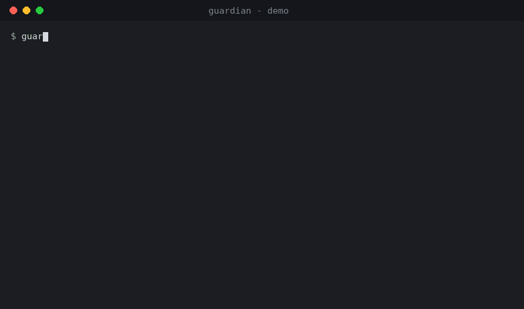
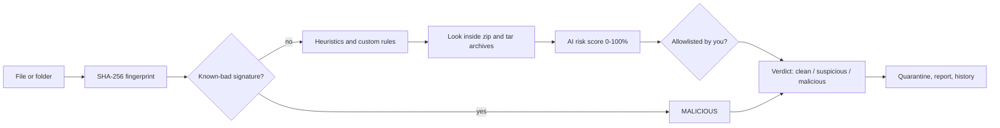

# Guardian

**A small, readable, cross-platform security scanner, built to be learned from.**
Windows, macOS and Linux. Pure Python standard library, zero dependencies.



> **Honest scope:** Guardian is an educational project, not a replacement for a
> professional antivirus. It detects real things (see below) but has no kernel
> driver, no live behaviour monitoring and no cloud intelligence. Keep a proven
> antivirus such as Microsoft Defender running on your real computer.

## Features

| Feature | What it does |
|---|---|
| **Signature scanning** | SHA-256 fingerprints checked against a known-bad database; fresh threat lists via `guardian update` |
| **Heuristics** | Double extensions (`invoice.pdf.exe`), programs disguised by file type, packed code, malware-style script commands, macros |
| **AI risk score** | A small logistic-regression model combines every signal into a 0-100% risk and explains *why*; can be retrained |
| **Archive scanning** | Looks inside `.zip` / `.tar.gz` (even nested) **in memory**, with zip-bomb and zip-slip protection |
| **Custom rules** | Add your own detections in a JSON file, no code changes (literal strings only, so rules can't freeze the scanner) |
| **Fast scans** | Parallel threads plus a cache that skips files unchanged since the last scan |
| **Quarantine** | Isolates dangerous files instead of deleting them; fully restorable |
| **Download guard** | `guardian watch` scans new files in your Downloads folder as they arrive |
| **Link checker** | Scores a URL for phishing signs *before* you click it |
| **Startup audit** | Read-only list of everything that launches at boot, with suspicious entries flagged |
| **Allowlist** | Mark an exact file as safe to stop a false alarm (known malware can never be allowlisted) |
| **History and reports** | Every scan is recorded in SQLite; export HTML or JSON reports |
| **Jarvis advisor** | Plain-language explanations offline; optional AI explanations (sends only a summary, never your files) |

## Quick start

Requires **Python 3.10 or newer**. No packages to install.

```bash
git clone https://github.com/<your-username>/guardian.git
cd guardian

python -m guardian scan ~/Downloads            # scan a folder (Windows: C:\Users\you\Downloads)
python -m guardian scan ~/Downloads -q         # ...and quarantine anything malicious
python -m guardian scan . --report report.html # save a shareable report
python -m guardian watch                       # guard your Downloads folder live
python -m guardian url "http://example.com"    # check a link before clicking
python -m guardian autoruns                    # audit startup programs
python -m guardian status                      # what Guardian knows, when it last updated
python -m guardian update                      # download fresh threat data
python -m guardian gui                         # open the window app
```

Optional: `pip install .` adds a plain `guardian` command.

**Try it safely.** Never test with real malware. Use the EICAR test string, a
harmless file that every antivirus agrees to flag:

```bash
python -c "from guardian.signatures import EICAR; open('eicar_test.txt','wb').write(EICAR)"
python -m guardian scan eicar_test.txt
```

(Some antivirus programs will delete that file instantly. That proves *they* work.)

## How it works

Every file passes through layers of defence. No single check is perfect, so
they are stacked ("defence in depth"), from most certain to least:



1. **Signature** - a fingerprint match is near-certain, with almost no false alarms, but only catches threats already seen.
2. **Heuristics and rules** - rules of thumb that catch *new* threats ("a `.jpg` that is secretly a program").
3. **AI score** - each signal becomes a number; a model weighs them into one probability. Simple on purpose, so every verdict is explainable.
4. **Archives** - malware usually arrives zipped, so contents are inspected too, in memory and with hard limits.
5. **You have the final say** - the allowlist cancels a heuristic false alarm for one exact file, never a known-malware match.

The full walkthrough, with the *reason* behind every file and design choice, is
in **[LEARNING_GUIDE.md](LEARNING_GUIDE.md)**.

### Project layout

```
guardian/
  hashing.py      fingerprints and entropy
  signatures.py   known-bad database
  heuristics.py   rules of thumb -> numbers
  rules.py        your custom JSON rules
  ai_score.py     the learning model
  archive.py      safe zip/tar inspection
  allowlist.py    files you trust
  scanner.py      combines every layer; parallel + cached
  quarantine.py   isolate, never delete
  history.py      SQLite history and cache
  report.py       HTML / JSON reports
  watcher.py      real-time download guard
  urlcheck.py     link safety
  updater.py      fresh threat data
  autoruns.py     startup audit
  advisor.py      plain-language explanations
  cli.py / gui.py the interfaces (the engine never imports these)
tests/            48 tests
tools/            regenerate the demo GIF
```

## Run the tests

```bash
python -m unittest discover tests -v
```

The suite covers detection, archives (including zip bombs and zip-slip names),
rules, allowlist safety, the cache, SQL-injection and HTML-injection attempts,
and the command line. GitHub Actions runs it on Windows, macOS and Linux.

## Roadmap

**Done**
- [x] Signatures, heuristics, AI scoring, quarantine, download guard, link checker
- [x] Archive scanning, custom rules, allowlist, parallel and cached scans
- [x] Startup audit, scan history, HTML/JSON reports

**Next**
- [ ] Digitally signed threat and model updates (verify before trusting)
- [ ] OS-level file notifications instead of polling (`watchdog`)
- [ ] Window app: progress bar, quarantine manager, history view
- [ ] Scan inside Office files for embedded executables
- [ ] Proper train / validation / test evaluation of the model (precision and recall)
- [ ] Installers: Windows `.exe`, macOS `.app`, Linux AppImage

**Later**
- [ ] Cloud API that returns verdicts for hashes and URLs
- [ ] Android app (scan downloads, link guard, advisor), Flutter or Kotlin
- [ ] iOS app (link and phishing guard, advisor; iOS does not allow file scanning)
- [ ] Behaviour monitoring, and import of community YARA rules
- [ ] Phishing and payment-scam warnings in Indian languages

## Limitations (please read)

- No real-time protection of running programs; the download guard polls a folder.
- No detection of threats that exist only in memory, or of kernel-level malware.
- The AI is a small hand-weighted model, not a deep-learning system trained on millions of files.
- Threat-feed addresses in `updater.py` may change; some feeds need a free account.
- Window app and the macOS/Windows startup audit are written carefully but have had less testing than the Linux paths.

## About this project

Built as a learning project, with AI assistance (Claude) for the code and the guide.
Contributions and questions are welcome.

## License

[MIT](LICENSE)
